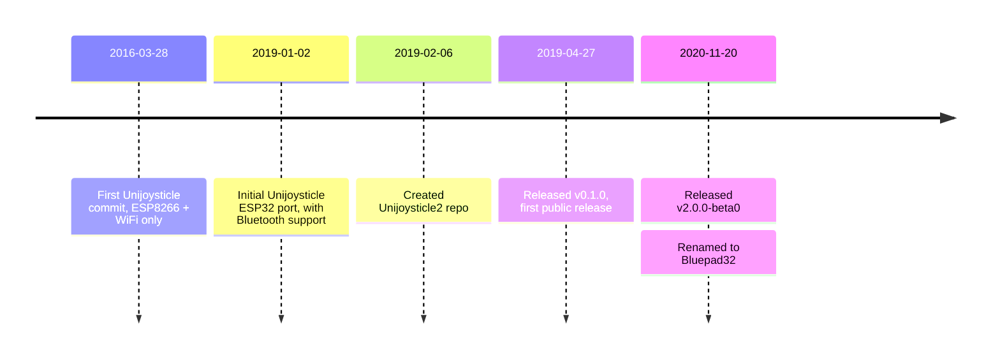

# FAQ

## Why can't I connect my DualShock or Switch controller to my ESP32-S3 or ESP32-C3?

???+ note "TL;DR"

    Answer: ESP32-S3 and ESP32-C3 do not support the Bluetooth Classic protocol.

Only the original ESP32 chip supports Bluetooth Classic (`BR/EDR`). ESP32-S3,
ESP32-C3, ESP32-C5, ESP32-C6, and ESP32-H2 do not support `BR/EDR`.

Switch, Wii, DualSense, and DualShock controllers use `BR/EDR` instead of `BLE`.
Use an original ESP32 or a Pico W to connect `BR/EDR` controllers.

The following tables list chip and controller protocols. For the latest support
list, see [Supported gamepads][supported_gamepads].

| Chip     | BR/EDR           | BLE              |
|----------|------------------|------------------|
| ESP32    | :material-check: | :material-check: |
| ESP32-S3 |                  | :material-check: |
| ESP32-C3 |                  | :material-check: |
| ESP32-C5 |                  | :material-check: |
| ESP32-C6 |                  | :material-check: |
| ESP32-H2 |                  | :material-check: |
| Pico W   | :material-check: | :material-check: |
| Pico 2 W | :material-check: | :material-check: |

Supported Bluetooth gamepads and their protocols:

| Gamepad                 | BR/EDR               | BLE                  |
|-------------------------|----------------------|----------------------|
| DualSense (PS5)         | :material-check:     |                      |
| DualShock 4 (PS4)       | :material-check:     |                      |
| DualShock 3 (PS3)       | :material-check:     |                      |
| Nintendo Switch Pro     | :material-check:     |                      |
| Nintendo Switch JoyCons | :material-check:     |                      |
| Nintendo Wii U Pro      | :material-check:     |                      |
| Nintendo Wii Remote     | :material-check:     |                      |
| Nintendo Balance Board  | :material-check:     |                      |
| Xbox Wireless           | :material-check:*    | :material-check:*    |
| Xbox Adaptive           |                      | :material-check:*    |
| Steam                   |                      | :material-check:**   |
| Stadia                  |                      | :material-check:***  |
| Android                 | :material-check:**** | :material-check:**** |
| 8BitDo                  | :material-check:     |                      |
| Atari                   | :material-check:     |                      |
| iCade                   | :material-check:     |                      |
| Nimbus                  | :material-check:     |                      |
| OUYA 1st gen            | :material-check:     |                      |

*: Xbox Controller Firmware v3.x and v4.x use BR/EDR. Firmware v5.x and newer
use BLE.

**: Requires the [Steam Controller Bluetooth firmware update][steam_instructions].

***: Requires the [Stadia Bluetooth firmware update][stadia_instructions].

****: Android controllers use either BR/EDR or BLE.

[steam_instructions]: https://help.steampowered.com/en/faqs/view/1796-5FC3-88B3-C85F

[stadia_instructions]: https://stadia.google.com/controller/index_en_US.html

## What are the supported boards?

???+ note "TL;DR"

    Answer: [Pico W][pico_w] and [ESP32-family][esp32_family] boards.

Bluepad32 supports Bluetooth-enabled Pico W and ESP32 processors.

On ESP32, Bluepad32 runs on the main processor, such as the
[Espressif ESP32-DevKitC][espressif_esp32_devkitc].

If standard Arduino supports an ESP32 board, Bluepad32 also supports that board.

[pico_w]: https://www.raspberrypi.com/documentation/microcontrollers/raspberry-pi-pico.html

[esp32_family]: https://www.espressif.com/en/products/modules

[espressif_esp32_devkitc]: https://docs.espressif.com/projects/esp-idf/en/latest/esp32/hw-reference/esp32/get-started-devkitc.html

## How do I pair one controller to one specific board?

???+ note "TL;DR"

    Answer: Use the Bluetooth allowlist.

Suppose you want to control eight robots with eight separate controllers.
Controller A must control only robot A, and controller B must control only
robot B.

Use one of these two methods to configure the allowlist:

- Call the `uni_bt_allowlist` API in your code
- Run allowlist commands from the USB console

### Use the `uni_bt_allowlist` API

Use these core functions from the `uni_bt_allowlist` API:

- `bool uni_bt_allowlist_add_addr(bd_addr_t addr);`: Adds a Bluetooth address to
    the allowlist.
- `void uni_bt_allowlist_set_enabled(bool enabled);`: Enables or disables the
    allowlist.

For the full API reference, see [uni_bt_allowlist.h].

Complete example:

```c++
// Arduino sketch
// Include Uni API.
#include <uni.h>

// The address of the gamepad that is allowed to connect.
// You can add up to four entries.
static const char * controller_addr_string = "00:11:22:33:44:55";

void setup() {
    // Add the following lines inside setup():
    bd_addr_t controller_addr;

    // Parse human-readable Bluetooth address.
    sscanf_bd_addr(controller_addr_string, controller_addr);

    // Bluepad32 saves this address in Non-Volatile Storage (NVS).
    // The address persists across reboots.
    // Duplicate entries are ignored.
    // You can add up to four entries in the allowlist.
    uni_bt_allowlist_add_addr(controller_addr);

    // Enable the allowlist.
    // Bluepad32 also saves this setting in NVS.
    uni_bt_allowlist_set_enabled(true);
}
```

### Use allowlist commands from the USB console

!!! Note

    Only the [Arduino ESP-IDF Template][arduino_esp_idf_template] project, the
    [ESP-IDF raw API][esp_idf_raw], and [Unijoysticle][unijoysticle_doc]
    provide the USB console.

1.  Open your serial terminal to access the USB console:

    ```
    # The serial port name can vary
    # Or run: minicom -D /dev/ttyUSB0
    tio /dev/ttyUSB0
    ```

2.  Type `help` in the console:

    ```
    bp32> help
    ```

Use these allowlist console commands:

- `allowlist_list`: List allowlist addresses
- `allowlist_add <bt addr>`: Add an address to the allowlist
- `allowlist_remove <bt addr>`: Remove an address from the allowlist
- `allowlist_enable <0 | 1>`: Disable (`0`) or enable (`1`) the allowlist

Watch the demonstration video:

[](https://asciinema.org/a/649043)

Bluepad32 saves allowlist addresses and the enabled state in Non-Volatile
Storage (NVS). These settings persist when you reset the ESP32.

[arduino_esp_idf_template]: https://bluepad32.readthedocs.io/en/latest/plat_arduino/#option-b-use-esp-idf-template-project

[esp_idf_raw]: https://github.com/ricardoquesada/bluepad32/tree/main/examples/esp32

[unijoysticle_doc]: https://bluepad32.readthedocs.io/en/latest/plat_unijoysticle/

[uni_bt_allowlist.h]: https://github.com/ricardoquesada/bluepad32/blob/main/src/components/bluepad32/include/bt/uni_bt_allowlist.h

## How do I detect when a gamepad is out of range?

???+ note "TL;DR"

    Answer: Disconnect the controller if no data arrives within 5 seconds.

Bluetooth has a limited wireless range:

| BR/EDR           | BLE             |
|------------------|-----------------|
| up to 100 meters | up to 50 meters |

When a gamepad moves out of range, the board stops receiving input packets. The
Bluetooth stack can take 20 seconds or more to detect a lost link and close the
connection.

Track the last update timestamp and disconnect the controller after a timeout:

```c++
// Arduino Sketch

void processControllers() {
    for (auto myController : myControllers) {
        if (myController && myController->isConnected()) {
            if (myController->hasData()) {
                // Process controller input
                processGamepad(myController);
                lastUpdate = millis();
            } else {
                // No data arrived from the controller.
                if ((millis() - lastUpdate) > 5000) {
                    // Stop the car if no data arrives for 5000 ms.
                    stopCar();
                    myController->disconnect();
                }
            }
        }
    }
}

void loop() {
    bool dataUpdated = BP32.update();
    if (dataUpdated) {
        processControllers();
    }

    vTaskDelay(1);
}
```

See [GitHub Issue #42][github_issue_42] for more details.

[github_issue_42]: https://github.com/ricardoquesada/bluepad32/issues/42

## Can you add support for an unsupported controller?

???+ note "TL;DR"

    Answer: Send us the controller hardware and we will try to add support.

1.  Verify that your controller is not already on these lists:

    * [Supported gamepads][supported_gamepads] :material-gamepad-variant:
    * [Supported mice][supported_mice] :material-mouse:
    * [Supported keyboards][supported_keyboards] :material-keyboard:

2.  If Bluepad32 does not support your controller, send a private message on
    [Discord][discord_server] :simple-discord: or [file a feature request][github_bug] :simple-github:.

Follow this process to sponsor controller support:

* Send a purchase link for the controller (such as Amazon or AliExpress).
* Send the cost of the controller plus US shipping via [PayPal][paypal] :simple-paypal:,
    [Ko-fi][kofi] :simple-kofi:, [Venmo][venmo] :simple-venmo:, or an Amazon
    gift card.
* We will buy the controller and attempt to add support. We cannot guarantee
    compatibility, especially for low-cost clone controllers.

[discord_server]: https://discord.gg/r5aMn6Cw5q

[github_bug]: https://github.com/ricardoquesada/bluepad32/issues

[kofi]: https://ko-fi.com/ricardoquesada

[paypal]: https://www.paypal.com/paypalme/RicardoQuesada

[supported_gamepads]: ../supported_gamepads/

[supported_keyboards]: ../supported_keyboards/

[supported_mice]: ../supported_mice/

[venmo]: https://account.venmo.com/u/Ricardo-Quesada

## Why does the internal Bluepad32 API use the `uni` prefix?

???+ note "TL;DR"

    Answer: Legacy naming from the Unijoysticle2 project.

The [Unijoysticle2][unijoysticle2] project originally combined hardware and
firmware in a single repository. In November 2020, we ported the Unijoysticle
firmware to the Adafruit AirLift module.

That port decoupled the firmware from the Unijoysticle2 hardware. We kept the
`uni` prefix to minimize code changes across the internal C API.

The Bluepad32 Arduino C++ API does not use the `uni` prefix because it is a new
interface.

## Why does Bluepad32 use BTstack as the Bluetooth stack?

???+ note "TL;DR"

    Answer: BTstack was the only Bluetooth Classic stack for ESP32 in 2019.

In January 2019, ESP32 lacked an open Bluetooth Classic (`BR/EDR`) HID host
implementation.

We chose [BlueKitchen BTstack][btstack] instead of writing a custom stack.
BTstack provides two major benefits:

- Pico W also uses BTstack, which simplified the Pico W port.
- BTstack runs on POSIX systems, which accelerates development for new
    controllers.

[btstack]: https://github.com/bluekitchen/btstack

## Which IDE should I use?

???+ note "TL;DR"

    Answer: Use the IDE that matches your workflow.

Select an IDE based on your C and C++ experience:

* [Arduino IDE][arduino_ide]: Best for standard Arduino sketches.
* [Visual Studio Code][vscode]: General-purpose editor that supports C and C++
    through extensions.
* [CLion][clion]: Full-featured IDE for C and C++ development.

[arduino_ide]: https://www.arduino.cc/en/software

[vscode]: https://code.visualstudio.com/

[clion]: https://www.jetbrains.com/clion/

## When did the Bluepad32 project start?

???+ note "TL;DR"

    Answer: Bluetooth support started in 2019 from the 2016 Unijoysticle
    project, and took the name Bluepad32 in 2020.

- Started the [Unijoysticle][unijoysticle] project (WiFi gamepad for Commodore
    64) on [2016-03-28][uni1_first_commit].
- Added Bluetooth support on [2019-01-02][fw_first_commit].
- Created the Unijoysticle2 repository on [2019-02-06][fw_uni2_repo].
- Published firmware release v0.1.0 on [2019-04-27][fw_first_release].
- Renamed the firmware to Bluepad32 in [November 2020][fw_as_bluepad32].



[unijoysticle]: https://retro.moe/unijoysticle

[uni1_first_commit]: https://github.com/ricardoquesada/unijoysticle/commit/fee5182337e055bd20cf549afa70f88fdc3fcf41

[unijoysticle2]: https://retro.moe/unijoysticle2/

[fw_first_commit]: https://github.com/ricardoquesada/unijoysticle/commit/80af0337d93e6646128949ef6d565203eb2a8385

[fw_uni2_repo]: https://github.com/ricardoquesada/unijoysticle2/commit/d99d35b207e9a825bf5de27f2ac5fd602eafd7d4

[fw_first_release]: https://github.com/ricardoquesada/unijoysticle2/releases/tag/release_firmware_v0.1.0

[fw_as_bluepad32]: https://retro.moe/2020/11/24/bluepad32-gamepad-support-for-esp32/
