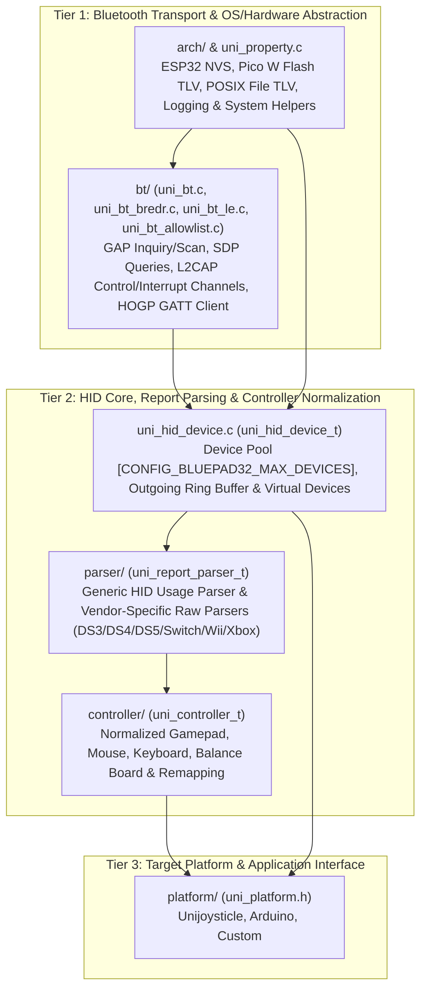
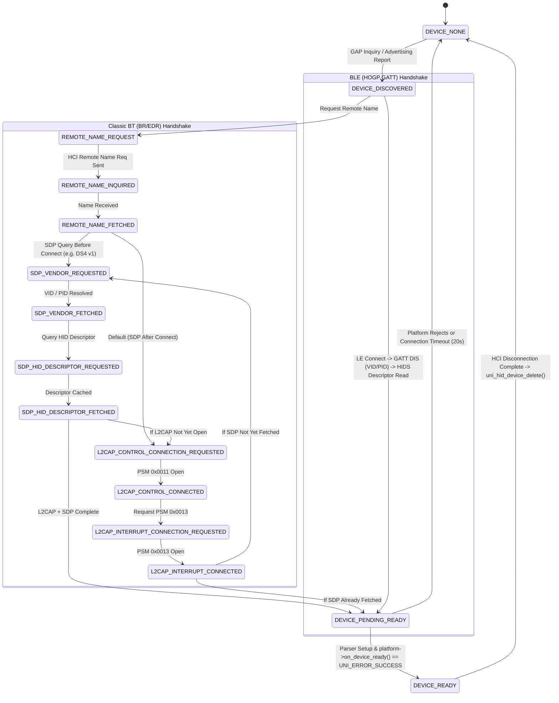
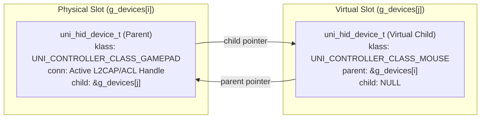

# Bluepad32 Architecture

Bluepad32 is a modular Bluetooth HID Host firmware component in C11 on top of
the [BTstack][btstack] Bluetooth stack. This architecture decouples core
Bluetooth protocols, HID report parsers, and controller normalization from
target hardware, operating systems, and host interfaces.

```
  ┌──────────────┐ ┌──────────┐ ┌──────────┐
  │              │ │          │ │          │
  │ Unijoysticle │ │ Arduino  │ │ Custom   │      Platforms
  │              │ │          │ │          │
  └────────┬─────┘ └────┬─────┘ └───┬──────┘
           │            │           │
           │            │           │
      ┌────▼────────────▼───────────▼───────┐
      │                                     │
      │                                     │
      │                                     │           Firmware
      │              Bluepad32              │
  ┌───┤                                     │
  │   │                                     │
  │   │                                     │
  │   └─────┬──────────────────┬────────────┘
  │         │                  │
  │         │                  │
  │         │   ┌──────────────▼────────────┐
  │         │   │                           │
  │         │   │           BTstack         ├───────────────┐    Bluetooth Stack
  │         │   │                           │               │
  │         │   └────┬──────┬─────────┬─────┘               │
  │         │        │      │         │                     │
  │         │        │      │         │                     │
  │      ┌──▼────────▼───┐  │         │                     │
  │      │               │  │         │                     │
  │      │   FreeRTOS    │  │         │                     │
  │      │               │  │         │                     │
  │      └──────┬────────┘  │         │                     │
  │             │           │         │                     │
┌─▼─────────────▼───────────▼─┐ ┌─────▼──────────┐ ┌────────▼──────────────┐
│                             │ │                │ │                       │
│            ESP-IDF          │ │    Pico SDK    │ │    Posix / libusb     │    Operating System
│                             │ │                │ │                       │
└────────────────┬────────────┘ └────────┬───────┘ └───────────┬───────────┘
                 │                       │                     │
                 │                       │                     │
┌────────────────▼────────────┐ ┌────────▼───────┐ ┌───────────▼───────────┐
│                             │ │                │ │                       │
│                             │ │                │ │                       │
│         ESP32 family        │ │  Raspberry Pi  │ │         Posix         │
│                             │ │                │ │                       │     Hardware
│     ESP32, ESP32-S3, etc    │ │  Pico W family │ │      Linux, macOS     │
│                             │ │                │ │                       │
│                             │ │                │ │                       │
└─────────────────────────────┘ └────────────────┘ └───────────────────────┘
```

---

## 1. Three-Tier and Six-Subsystem Layer Breakdown

The `src/components/bluepad32/` directory contains six decoupled subsystems
across three architectural tiers:



| Tier | Subsystem Directory / Module | Core Responsibilities |
| :--- | :--- | :--- |
| **Tier 1: Transport & Arch** | `arch/` & `uni_property.c` | Implements OS and MCU primitives (`uni_system`, `uni_log`) and non-volatile key-value storage (`uni_property_esp32.c`, `uni_property_pico.c`, `uni_property_posix.c`). |
| **Tier 1: Transport & Arch** | `bt/` (`uni_bt*.c`) | Wraps BTstack HCI, GAP, SDP, L2CAP, and BLE GATT client state machines. Isolates Bluetooth protocol logic from the rest of Bluepad32. |
| **Tier 2: Core & Parsing** | `uni_hid_device.c` | Manages the static `uni_hid_device_t` pool (`CONFIG_BLUEPAD32_MAX_DEVICES`), connection timeouts, outgoing circular buffers (`uni_circular_buffer_t`), and composite `parent`/`child` virtual devices. |
| **Tier 2: Core & Parsing** | `parser/` (`uni_hid_parser*.c`) | Translates Bluetooth HID reports into normalized structs via `uni_report_parser_t` (`setup`, `init_report`, `parse_usage`, `parse_input_report`, `parse_feature_report`) and sends output reports. |
| **Tier 2: Core & Parsing** | `controller/` (`uni_controller*.c`) | Defines hardware-agnostic structs (`uni_gamepad_t`, `uni_mouse_t`, `uni_keyboard_t`, `uni_balance_board_t`), button and axis remapping (`uni_gamepad_remap`), and joystick converters (`uni_joystick.c`). |
| **Tier 3: Platform** | `platform/` (`uni_platform*.c`) | Delivers normalized controller events to the host application through the `struct uni_platform` callback interface (`on_init_complete`, `on_device_connected`, `on_device_ready`, `on_controller_data`, `on_device_disconnected`, `on_oob_event`). |

---

## 2. Bluetooth Connection State Machine (`uni_bt_conn_state_t`)

Bluepad32 supports two Bluetooth transport protocols:

* **Bluetooth Classic (`BR/EDR`)**: Supports DualShock 3, DualShock 4,
    DualSense, Nintendo Switch Pro, Wii Remote, and Xbox Wireless 1708.
* **Bluetooth Low Energy (`BLE` / HOGP)**: Supports Xbox Series X|S, Stadia,
    Steam Controller, Switch 2, and BLE mice and keyboards.

Each `uni_hid_device_t` embeds a `uni_bt_conn_t conn` struct. This struct
tracks the device state in `uni_bt_conn_state_t` from discovery to
`UNI_BT_CONN_STATE_DEVICE_READY`.



### Handshake Modes (`uni_sdp_query_type_t`)

* **`SDP_QUERY_AFTER_CONNECT` (Default)**: Opens L2CAP Control (`PSM 0x0011`)
    and Interrupt (`PSM 0x0013`) channels *before* it queries SDP for
    VID/PID (`0x0201`/`0x0202`) and the HID Report Descriptor (`0x0206`).
* **`SDP_QUERY_BEFORE_CONNECT`**: Completes the SDP query *before* it opens
    L2CAP channels. First-generation Sony DualShock 4 controllers require this
    sequence.
* **`SDP_QUERY_NOT_NEEDED`**: Skips Classic SDP queries. BLE controllers use
    GATT Device Information (`0x180A`) and HID (`0x1812`) services instead.

---

## 3. Dual-Mode HID Report Parsing and Virtual Devices

### 3.1 Dual-Mode Parser Dispatch (`uni_hid_parse_input_report`)

When a device reaches `DEVICE_PENDING_READY`, `uni_hid_device_set_ready()`
selects a `uni_report_parser_t` based on `(vendor_id, product_id)` and
controller type. When an input report arrives, `uni_hid_parse_input_report()`
runs four stages:

1.  **`report_parser.init_report(d)`**: Resets per-frame state before the
    parser decodes the packet.
2.  **Mode A — Raw Struct Parser
    (`report_parser.parse_input_report(d, report, report_len)`)**:
    * Parses proprietary binary reports for Sony DualShock 3/4, DualSense,
        Nintendo Switch Pro/Joy-Con, Wii Remote/Balance Board, and Xbox One.
    * Validates report lengths, casts payloads to packed C structs, applies
        IMU calibration (`parse_feature_report`), and updates `d->controller`.
3.  **Mode B — Descriptor-Driven Usage Parser
    (`report_parser.parse_usage(d, &globals, usage_page, usage, value)`)**:
    * Parses standard HID gamepads, keyboards, mice, Android, 8BitDo, and
        Stadia controllers.
    * Iterates through the HID Report Descriptor with
        `btstack_hid_parser_init()`.
    * Normalizes axes to `[-511, 512]` via `uni_hid_parser_process_axis()` and
        pedals to `[0, 1020]` via `uni_hid_parser_process_pedal()`.
4.  **Platform Delivery**: Passes the normalized `uni_controller_t` to
    `uni_get_platform()->on_controller_data(d, &d->controller)`.

### 3.2 Composite Controllers and Virtual Devices (`parent` / `child`)

Some Bluetooth controllers expose multiple logical input devices on one wireless
link. For example, **Sony DualShock 4** and **DualSense** controllers combine a
gamepad with a capacitive touchpad mouse.



* **Creation (`uni_hid_device_create_virtual`)**: If
    `uni_virtual_device_is_enabled()` returns `true` during `setup()`, the
    parent parser allocates a second `uni_hid_device_t` slot from `g_devices[]`.
    It initializes the child slot with `uni_hid_device_init()`, copies parent
    metadata (`vendor_id`, `product_id`, `btaddr`), and links `parent->child`
    and `child->parent`.
* **Data Routing**: When `parse_input_report()` decodes touchpad packets, it
    writes mouse deltas and buttons into `d->child->controller.mouse`. It then
    calls `uni_hid_device_process_controller(d->child)` to deliver separate
    gamepad and mouse events.
* **Lifecycle and Teardown Safety (`uni_hid_device_delete`)**:
    * When Bluepad32 deletes a parent device, it recursively deletes `d->child`
        and sets `d->child = NULL`.
    * When Bluepad32 deletes a virtual child device, it sets
        `d->parent->child = NULL` to prevent dangling pointers.
    * Before `uni_hid_device_init()` zeroes a device slot,
        `uni_hid_device_delete()` unregisters `connection_timer`,
        `inquiry_remote_name_timer`, and `misc_button_delay_timer` from BTstack.

---

## 4. BTstack Single-Threaded Run Loop and `CMD_CALLBACK_MAX`

Neither BTstack nor Bluepad32 is thread-safe. All Bluetooth packet handlers,
timers, HID parsers, and platform callbacks execute sequentially on a single
**BTstack Run-Loop Thread**.

External threads (such as Arduino `loop()` on ESP32 Core 1) must use
asynchronous dispatch to invoke Bluetooth operations safely:

1.  **`*_safe` Asynchronous Dispatch**: Functions with the `_safe` suffix (such
    as `uni_bt_start_scanning_and_autoconnect_safe()`, `uni_bt_del_keys_safe()`,
    and `uni_bt_disconnect_device_safe()`) do not mutate BTstack state directly.
2.  **Pre-Allocated Registration Ring Buffer (`CMD_CALLBACK_MAX = 8`)**:
    * `uni_bt.c` maintains an 8-slot circular array of
        `btstack_context_callback_registration_t` structs
        (`cmd_callback_registration[CMD_CALLBACK_MAX]`).
    * Each `_safe()` call selects the next slot
        (`cmd_callback_idx = (cmd_callback_idx + 1) % CMD_CALLBACK_MAX`), packs
        the command ID and 16-bit argument into `cmd->context`, and calls
        `btstack_run_loop_execute_on_main_thread(cmd)`.
    * **Rate-Limiting Invariant**: External tasks must not issue more than
        `CMD_CALLBACK_MAX` (`8`) concurrent `_safe()` calls per BTstack
        run-loop tick.

---

## 5. Non-Volatile Property System (`uni_property`) and Allowlist Persistence

Bluepad32 provides a unified property API (`uni_property.h` and
`uni_property.c`) to store persistent configuration keys (`bp.bt.allow_en`,
`bp.bt.allowlist`, `bp.ble.enabled`, `bp.gap.*`, `bp.mouse.scale`,
`bp.virt_dev_en`) across reboots:

* **Architecture Backends (`arch/`)**:
    * **ESP32 (`uni_property_esp32.c`)**: Stores properties in an ESP-IDF
        Non-Volatile Storage (`nvs_flash`) namespace (`"bp32"`).
    * **Pico W and POSIX (`uni_property_btstack_tlv.c`)**: Uses BTstack TLV
        storage (`btstack_tlv_flash_bank` on Pico W and RP2350, or
        `btstack_tlv_posix` at `/tmp/bp32_property.tlv` on POSIX). It supports
        all property types, including `UNI_PROPERTY_TYPE_STRING` and
        `UNI_PROPERTY_TYPE_FLOAT`.
* **Allowlist Boot and Runtime Persistence (`uni_bt_allowlist.c`)**:
    * On boot (`uni_bt_allowlist_init()`), `update_allowlist_from_property()`
        clears `addr_allow_list[]` and loads saved MAC addresses via
        `add_addr_internal(addr, /*persist=*/false)`. Skipping NVS/TLV writes
        during boot prevents flash wear and protects the `strtok_r` buffer.
    * Runtime updates (`uni_bt_allowlist_add_addr()`,
        `uni_bt_allowlist_remove_addr()`, `uni_bt_allowlist_remove_all()`)
        reject the zero MAC address (`00:00:00:00:00:00`) and write the updated
        list to `UNI_PROPERTY_IDX_ALLOWLIST_LIST`.

[btstack]: https://github.com/bluekitchen/btstack

