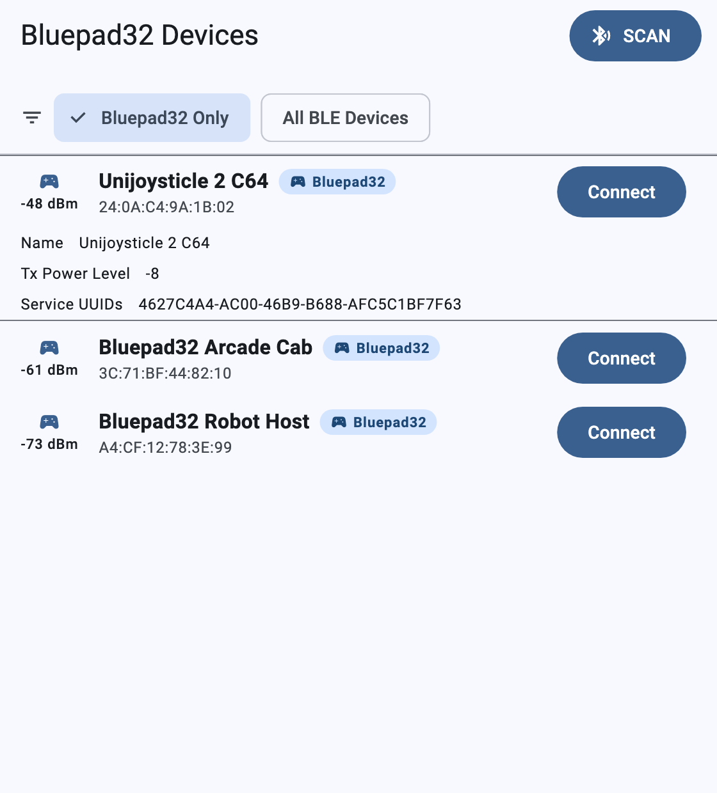
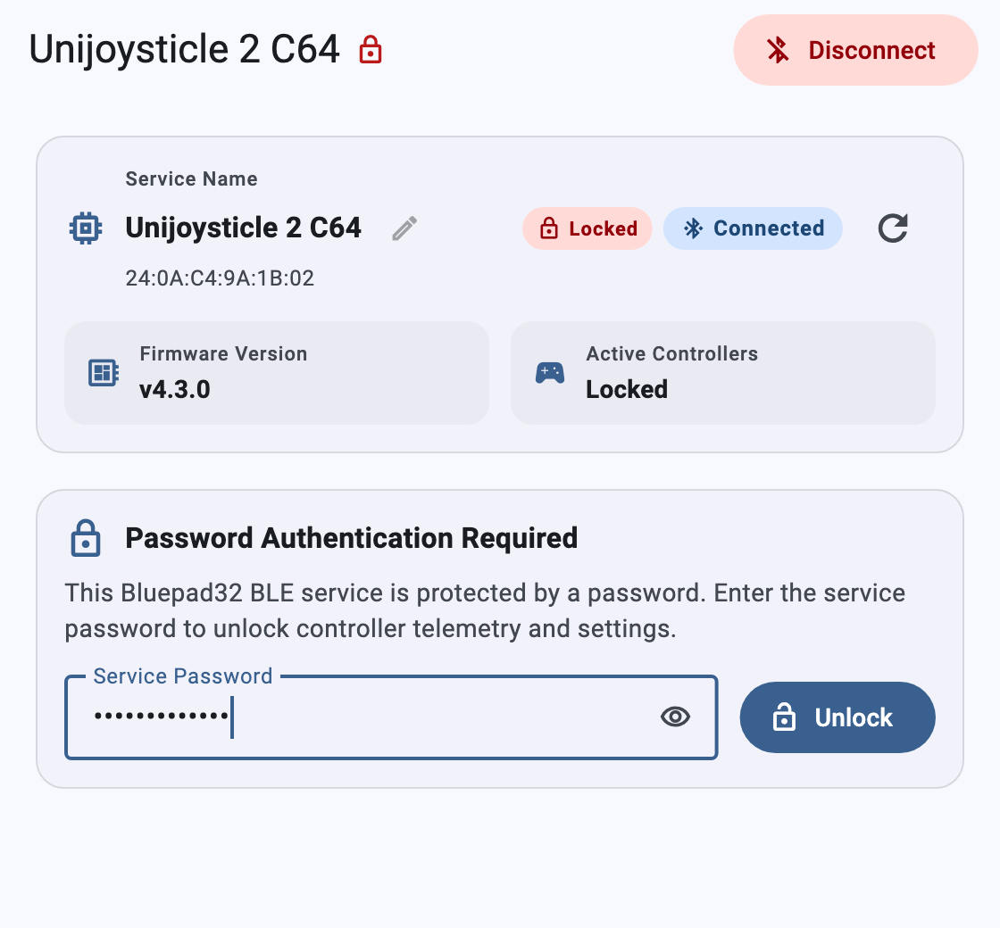
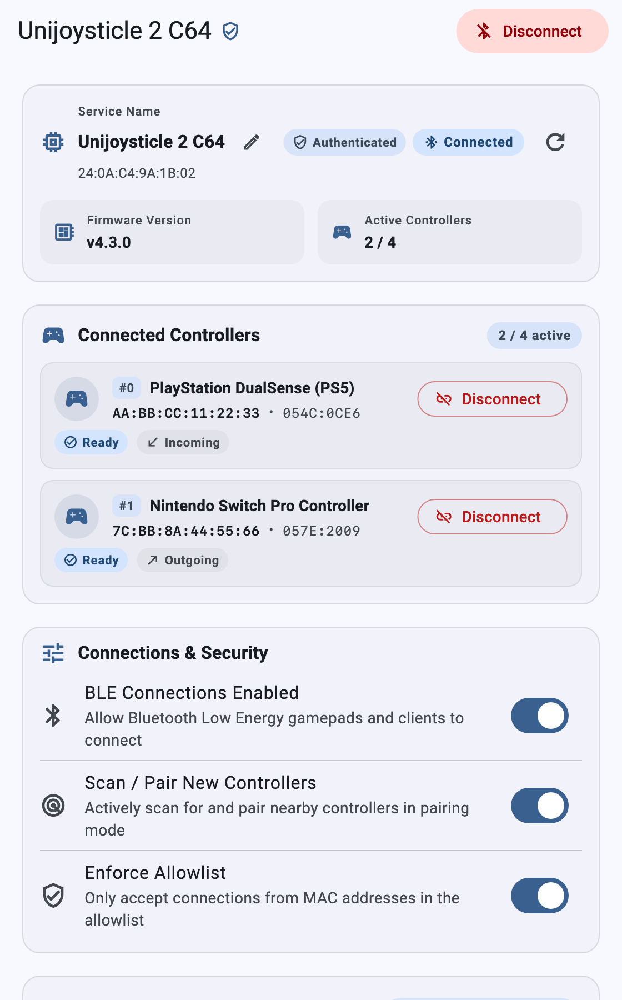
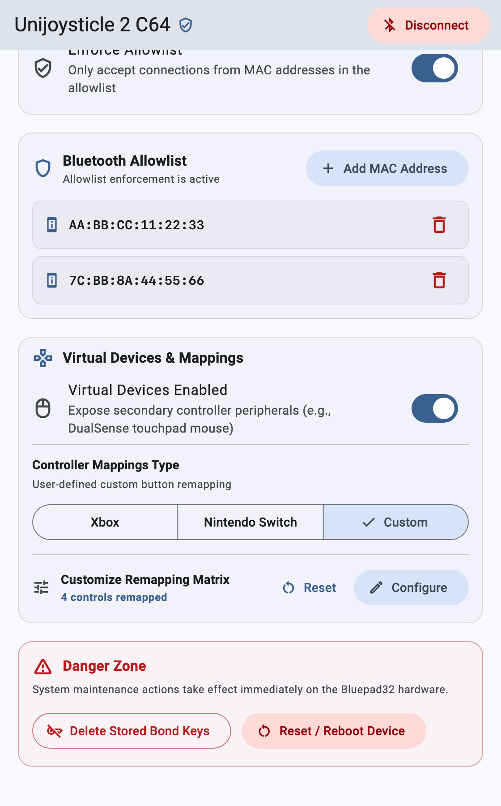
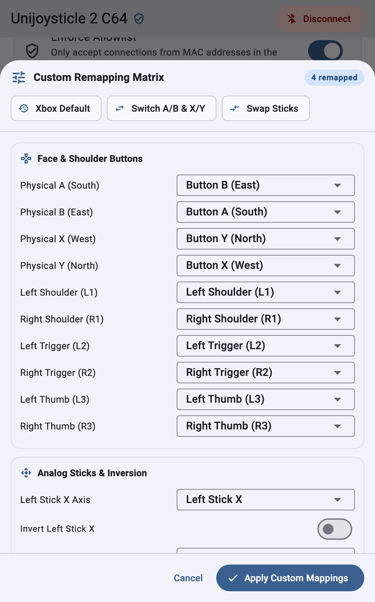

# Bluepad32 BLE Companion App

The [**Bluepad32 BLE Client**][ble_client_repo] is a cross-platform Flutter
application for **Android**, **iOS**, **macOS**, **Linux**, **Windows**, and
**Web Bluetooth**. It connects to the Bluepad32 BLE GATT configuration service
(`4627C4A4-AC00-46B9-B688-AFC5C1BF7F63`).

Use the companion app to monitor connected controllers and update runtime
settings over BLE. You do not need to reflash firmware or open a serial console:

* Monitor connected gamepads in real time (controller model, Bluetooth MAC
    address, Vendor/Product ID, and connection state).
* Disconnect individual controller slots remotely.
* Rename the Bluepad32 device (`1–29` UTF-8 bytes) and unlock password-protected
    boards (`1–31` UTF-8 bytes).
* Toggle BLE controller connections, controller scanning, and virtual child
    devices (such as DualSense and DualShock 4 touchpad mice).
* Select **Xbox**, **Nintendo Switch**, or **Custom** button presets, or edit
    all 28 fields of `uni_gamepad_mappings_t` in the **Custom Remapping
    Matrix**.
* Enforce a Bluetooth MAC allowlist and add or remove allowed controller MAC
    addresses.
* Clear stored Bluetooth pairing keys or reboot the microcontroller remotely.

[ble_client_repo]: https://github.com/ricardoquesada/bluepad32-ble-client

---

## 1. Enable the BLE Service on Bluepad32

Before you connect with the client app, enable the BLE configuration service on
your Bluepad32 device. Bluepad32 stores the service state (`bp.ble.svc_en`),
device name (`bp.ble.name`), and session password (`bp.ble.pass`) in
non-volatile storage (ESP32 NVS or BTstack TLV).

=== "ESP32 Serial Console"

    Open the serial console (`idf.py monitor`). Run `ble_service_enable`:

    ```sh
    # Enable and advertise the BLE configuration service
    ble_service_enable 1

    # (Optional) Set a custom advertised device name (1..29 UTF-8 bytes)
    ble_service_name "Unijoysticle 2 C64"

    # (Optional) Require a session password (1..31 UTF-8 bytes, or 'none' to clear)
    ble_service_password "arcade-secret"
    ```

=== "C API (BTstack Thread)"

    Inside a platform callback such as `on_init_complete()`, call the
    `uni_bt_service_*` functions from `bt/uni_bt_service.h`:

    ```c
    #include "bt/uni_bt_service.h"

    static void my_platform_on_init_complete(void) {
        // Optional: set the advertised BLE service name (max 29 UTF-8 bytes)
        uni_bt_service_set_name("Unijoysticle 2 C64");

        // Optional: protect the BLE service with a password (max 31 UTF-8 bytes)
        // Pass NULL or "" to leave the service open without a password.
        uni_bt_service_set_password("arcade-secret");

        // Enable and advertise the BLE configuration service
        uni_bt_service_set_enabled(true);
    }
    ```

=== "C API (From Any Thread / Task)"

    From an external FreeRTOS task or Arduino `loop()`, call the thread-safe
    wrapper from `bt/uni_bt.h`:

    ```c
    #include "bt/uni_bt.h"

    // Schedule BLE service activation on the BTstack run-loop thread
    uni_bt_enable_service_safe(true);
    ```

---

## 2. Install the Bluepad32 BLE Client

Download a prebuilt release binary from the
[Bluepad32 BLE Client Releases][ble_client_releases] page, or build the Flutter
app from source:

| Platform | Release Asset | Requirements |
| :--- | :--- | :--- |
| **Android** | `bluepad32-android.apk` | Android 5.0+ (API 21+) |
| **iOS** | `bluepad32-ios.ipa` | iOS 12+ |
| **macOS** | `bluepad32-macos-universal.zip` | macOS 10.14+ (Universal `x86_64` + `arm64`, signed and notarized) |
| **Linux (x64 / ARM64)** | `bluepad32-linux-amd64.tar.gz` / `bluepad32-linux-arm64.tar.gz` | Linux desktop with `bluez` |
| **Windows (x64)** | `bluepad32-windows-amd64.zip` | Windows 10+ (`x64` via WinRT BLE) |
| **Web** | `bluepad32-web.tar.gz` | Chrome or Edge with Web Bluetooth support |

To run from source with the [Flutter SDK](https://docs.flutter.dev/get-started/install):

```sh
git clone https://github.com/ricardoquesada/bluepad32-ble-client.git
cd bluepad32-ble-client/src
flutter pub get

# Run on macOS, Linux, Windows, Chrome, or a connected mobile device
flutter run -d macos
```

[ble_client_releases]: https://github.com/ricardoquesada/bluepad32-ble-client/releases

---

## 3. How to Use the Client

### Step 1: Discover and Connect to a Bluepad32 Device

<figure markdown="span">
  { width="420" }
  <figcaption>Scan for nearby Bluepad32 peripherals filtered by the Bluepad32 GATT service UUID.</figcaption>
</figure>

1.  Open the **Bluepad32 BLE Client**. Turn on Bluetooth on your computer or
    phone.
2.  Select the **Bluepad32 Only** filter chip. Tap **SCAN**. The client filters
    BLE advertisements by the Bluepad32 service UUID
    (`4627C4A4-AC00-46B9-B688-AFC5C1BF7F63`) and sorts boards by RSSI.
3.  Tap a device row to expand its advertisement metadata (local name, TX power
    level, and service UUIDs).
4.  Tap **Connect** to open the device dashboard.

### Step 2: Unlock a Password-Protected Session (If Enabled)

<figure markdown="span">
  { width="420" }
  <figcaption>Unlock a password-protected Bluepad32 peripheral through characteristic AC0E.</figcaption>
</figure>

If the Bluepad32 board requires a session password (`bp.ble.pass` /
characteristic `AC0E`), the dashboard shows a **Locked** badge. The firmware
blocks protected GATT reads, writes, and controller notifications until you
authenticate:

1.  Enter the service password (`1–31` UTF-8 bytes) in the **Service Password**
    field.
2.  Tap **Unlock** to authenticate the BLE connection. The badge changes to
    **Authenticated**, and the client loads all controller telemetry and
    settings.

### Step 3: Monitor Controllers and Configure Radio Settings

<figure markdown="span">
  { width="420" }
  <figcaption>System Info, live Connected Controllers telemetry (AC05), and Connections & Security toggles.</figcaption>
</figure>

* **System Info Card (`AC01`, `AC02`, `AC0D`, `AC0E`)**:
    * Shows the **Service Name**, hardware MAC address, authentication state,
        connection badge, **Firmware Version**, and **Active Controllers** count
        (`2 / 4`).
    * Tap the pencil icon next to the service name to rename the Bluepad32
        peripheral (`1–29` UTF-8 bytes). The firmware immediately updates the
        primary advertising packet (`ADV_IND`) and scan response packet
        (`SCAN_RSP`).
    * Tap the refresh icon to re-read all GATT characteristics from the board.
* **Connected Controllers Card (`AC05`, `AC0A`)**:
    * Streams real-time controller updates over ATT notifications. Each occupied
        slot shows its index (`#0`–`#3`), model name, Bluetooth MAC address,
        `VID:PID`, state (**Ready**), and direction (**Incoming** or
        **Outgoing**).
    * Tap **Disconnect** on any slot to disconnect that controller immediately.
* **Connections & Security Card (`AC03`, `AC04`, `AC07`)**:
    * **BLE Connections Enabled (`AC03`)**: Enables or disables Bluetooth Low
        Energy controller connections on the Bluepad32 host.
    * **Scan / Pair New Controllers (`AC04`)**: Starts or stops Bluetooth
        inquiry and scanning for controllers in pairing mode.
    * **Enforce Allowlist (`AC07`)**: Restricts controller connections to MAC
        addresses stored in the allowlist.

### Step 4: Manage the Bluetooth Allowlist, Mappings, and System Maintenance

<figure markdown="span">
  { width="420" }
  <figcaption>Bluetooth MAC Allowlist (AC08), Virtual Devices & Mappings (AC06/AC09), and Danger Zone actions (AC0B/AC0C).</figcaption>
</figure>

* **Bluetooth Allowlist Card (`AC08`)**:
    * Tap **+ Add MAC Address** to add a controller MAC address in
        `AA:BB:CC:DD:EE:FF` format.
    * Tap the trash icon next to any listed MAC address to remove it from
        non-volatile storage.
* **Virtual Devices & Mappings Card (`AC06`, `AC09`, `AC0F`)**:
    * **Virtual Devices Enabled (`AC09`)**: Toggles composite virtual child
        devices (such as the touchpad mouse on DualSense and DualShock 4
        controllers).
    * **Controller Mappings Type (`AC06`)**: Selects the **Xbox** (`A/B/X/Y`),
        **Nintendo Switch** (`B/A/Y/X`), or **Custom** remapping layout.
    * **Customize Remapping Matrix (`AC0F`)**: Shows how many controls differ
        from the default Xbox layout. Tap **Reset** to restore default Xbox
        mappings, or tap **Configure** to open the 28-field remapping editor.
* **Danger Zone Card (`AC0B`, `AC0C`)**:
    * **`Delete Stored Bond Keys` (`AC0B`)**: Opens a confirmation dialog and
        clears all saved Classic BT and BLE pairing keys from the board.
    * **`Reset / Reboot Device` (`AC0C`)**: Opens a confirmation dialog and
        reboots the Bluepad32 microcontroller.

### Step 5: Customize the 28-Field Remapping Matrix

<figure markdown="span">
  { width="420" }
  <figcaption>Interactive 28-field Custom Remapping Matrix editor (AC0F) with quick preset chips.</figcaption>
</figure>

Tap **Configure** in the **Virtual Devices & Mappings** card to open the
**Custom Remapping Matrix** sheet:

1.  **Quick Presets**: Tap **Xbox Default**, **Switch A/B & X/Y**, or **Swap
    Sticks** to load a preset layout.
2.  **Fine-Grained Control Remapping**: Select custom targets for any of the 28
    fields in `uni_gamepad_mappings_t` across five categories:
    * **Face & Shoulder Buttons**: `A`, `B`, `X`, `Y`, `L1`, `R1`, `L2`, `R2`,
        `L3`, and `R3` (10 fields).
    * **Analog Sticks & Inversion**: Left and Right Stick `X` and `Y` axis
        routing (4 fields) and per-axis inversion switches (4 fields).
    * **D-Pad Directions**: `Up`, `Down`, `Left`, and `Right` (4 fields).
    * **Triggers / Pedals**: `Brake (L2)` and `Throttle (R2)` analog routing (2
        fields).
    * **System & Misc Buttons**: `Select`, `Start`, `System`, and `Capture` (4
        fields).
3.  Tap **Apply Custom Mappings** to check and send the 28-byte matrix to the
    board over characteristic `AC0F`. This action also activates the **Custom**
    mapping type on `AC06`.

---

## 4. BLE GATT Service Reference (`uni_bt_service.c`)

The Bluepad32 BLE configuration server (`src/components/bluepad32/bt/uni_bt_service.c`)
exposes primary service `4627C4A4-AC00-46B9-B688-AFC5C1BF7F63` with these
characteristics:

| UUID Suffix | Characteristic | Properties | Wire Format | Auth Protected (`AC0E`) |
| :--- | :--- | :--- | :--- | :--- |
| `AC01` | Firmware Version | `READ` | UTF-8 string (for example, `"v4.3.0"`) | Public |
| `AC02` | Max Controller Slots | `READ` | `uint8` (`CONFIG_BLUEPAD32_MAX_DEVICES`, default `4`) | Protected |
| `AC03` | BLE Connections Enabled | `READ \| WRITE` | `uint8` (`0` = disabled, `1` = enabled) | Protected |
| `AC04` | Scan / Pair Controllers | `READ \| WRITE` | `uint8` (`0` = stopped, `1` = scanning) | Protected |
| `AC05` | Connected Controllers | `READ \| NOTIFY` | Array of 16-byte packed `compact_device_t` structs (`64B` for 4 slots) | Protected (incl. CCCD) |
| `AC06` | Controller Mappings Type | `READ \| WRITE` | `uint8` (`0` = Xbox, `1` = Switch, `2` = Custom) or `29B` atomic `[2, ...28B...]` | Protected |
| `AC07` | Allowlist Enabled | `READ \| WRITE` | `uint8` (`0` = disabled, `1` = enforced) | Protected |
| `AC08` | Allowlist MAC Addresses | `READ \| WRITE` | Read: packed 6-byte `bd_addr_t` array. Write: `[op, 6B_MAC]` (`op`: `0`=remove, `1`=add) | Protected |
| `AC09` | Virtual Devices Enabled | `READ \| WRITE` | `uint8` (`0` = disabled, `1` = enabled) | Protected |
| `AC0A` | Disconnect Controller | `WRITE` | `uint8` slot index (`0 .. max_devices - 1`) | Protected |
| `AC0B` | `Delete Stored Bond Keys` | `WRITE` | `uint8` (`1` = clear all stored Bluetooth keys) | Protected |
| `AC0C` | Reset / Reboot Device | `WRITE` | `uint8` (`1` = reboot microcontroller) | Protected |
| `AC0D` | BLE Service Name | `READ \| WRITE` | UTF-8 string (`1..29` bytes, updates `ADV_IND` + `SCAN_RSP` + `0x2A00`) | Public read / Protected write |
| `AC0E` | Session Password Auth | `READ \| WRITE` | Read: `uint8` (`0` = open, `1` = required, `2` = authenticated). Write: UTF-8 password (`1..31` bytes) | Public |
| `AC0F` | Custom Remapping Matrix | `READ \| WRITE` | 28-byte packed `uni_gamepad_mappings_t` struct | Protected |
