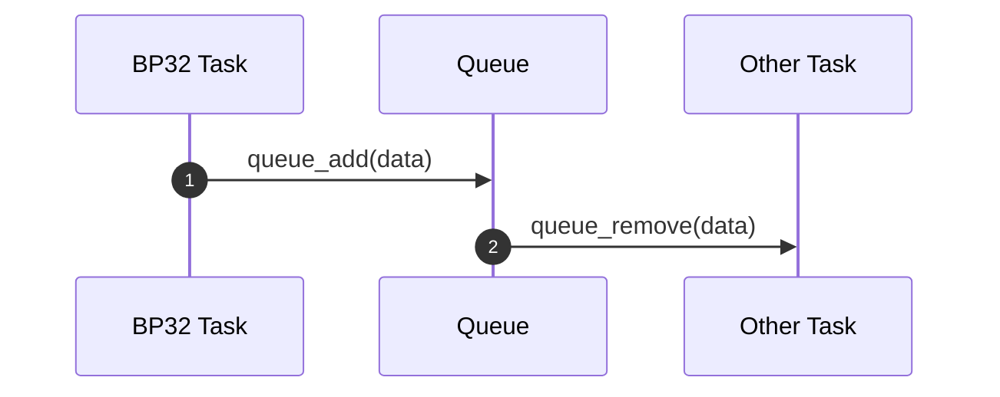

# Programmer's Guide: Raw API

This guide applies to projects that use the Pico SDK, ESP-IDF, or POSIX C APIs
directly. These example projects use the Raw API:

- [ESP32 example][esp32_example]
- [Pico W example][picow_example]
- [Posix example][posix_example]
- [Posix ImGui Diagnostic Suite][posix_imgui_example]

## Thread Safety

!!! note "TL;DR"

    Bluepad32 and BTstack are **not** thread-safe. Call Bluepad32 and BTstack
    APIs only from the BTstack thread, or use the `*_safe` cross-thread
    wrappers.

### Functions Safe to Call from the BTstack Thread

BTstack and Bluepad32 execute on the BTstack thread (or BTstack FreeRTOS task).
All Bluepad32 and BTstack callbacks run on this thread:

- Bluepad32 platform callbacks: `platform.on_controller_data()`,
    `platform.on_device_connected()`, `platform.on_device_ready()`,
    `platform.on_device_disconnected()`, and `platform.on_init_complete()`
- BTstack callbacks: packet handlers (`l2cap_packet_handler()`) and
    `btstack_run_loop_execute_on_main_thread()` callbacks

Inside these callbacks, you can call any Bluepad32 API (`uni_*`, including
`*_unsafe` functions) and any BTstack API (`btstack_*`, `gap_*`, `hci_*`,
`l2cap_*`, `gatt_*`).

### Functions Safe to Call from Any Thread

- `btstack_run_loop_execute_on_main_thread()`: Schedules a
    `btstack_context_callback_registration_t` callback to run on the BTstack
    thread.
- Bluepad32 `*_safe` functions: `uni_bt_start_scanning_and_autoconnect_safe()`,
    `uni_bt_stop_scanning_safe()`, `uni_bt_del_keys_safe()`, and
    `uni_bt_disconnect_device_safe()`.
- Stateless query helpers and pure conversion functions in the table below.

### Bluepad32 Thread-Safety Reference (`*_safe` vs. `*_unsafe`)

`bt/uni_bt.h` provides `_safe` and `_unsafe` variants for Bluetooth management
operations:

| Operation / Purpose | Cross-Thread Safe API (Any FreeRTOS Task / Core / ISR Context) | BTstack-Thread Only API (Platform Callbacks / Run-Loop Context) | Notes & Implementation Semantics |
| :--- | :--- | :--- | :--- |
| **Start Scanning & Autoconnect** | `uni_bt_start_scanning_and_autoconnect_safe(void)` | `uni_bt_start_scanning_and_autoconnect_unsafe(void)` | Starts Classic BT inquiry and BLE scanning (`CMD_BT_START_SCANNING`). |
| **Stop Scanning** | `uni_bt_stop_scanning_safe(void)` | `uni_bt_stop_scanning_unsafe(void)` | Stops active Classic BT inquiry and BLE scanning (`CMD_BT_STOP_SCANNING`). |
| **Enable/Disable New Connections (Deprecated)** | `uni_bt_enable_new_connections_safe(bool enabled)` | `uni_bt_enable_new_connections_unsafe(bool enabled)` | Calls `start_scanning_and_autoconnect` or `stop_scanning`. |
| **Delete Stored Bluetooth Bonding Keys** | `uni_bt_del_keys_safe(void)` | `uni_bt_del_keys_unsafe(void)` | Deletes Classic BT and BLE link keys from NVS or TLV (`CMD_BT_DEL_KEYS`). |
| **List Stored Bluetooth Bonding Keys** | `uni_bt_list_keys_safe(void)` | `uni_bt_list_keys_unsafe(void)` | Logs bonded Classic BT and BLE link keys (`CMD_BT_LIST_KEYS`). |
| **Disconnect & Delete a Controller** | `uni_bt_disconnect_device_safe(int device_idx)` | `uni_hid_device_disconnect(d)` + `uni_hid_device_delete(d)` | `_safe` encodes `device_idx` in the upper 16 bits of `context` (`CMD_DISCONNECT_DEVICE`). |
| **Dump Connected Devices to Console** | `uni_bt_dump_devices_safe(void)` | `uni_hid_device_dump_all(void)` | Prints all active `uni_hid_device_t` instances (`CMD_DUMP_DEVICES`). |
| **Enable/Disable BLE Config Service** | `uni_bt_enable_service_safe(bool enabled)` | `uni_bt_service_set_enabled(bool enabled)` | Toggles the BLE GATT telemetry and configuration service (`CMD_BLE_SERVICE_ENABLE`/`DISABLE`). |
| **Read Local Bluetooth MAC Address** | `uni_bt_get_local_bd_addr_safe(bd_addr_t addr)` | `memcpy(addr, uni_local_bd_addr, 6)` | Copies the cached 6-byte local `bd_addr_t`. |
| **Query Scanning / Incoming Flags** | `uni_bt_is_scanning(void)`, `uni_bt_incoming_connections_is_allowed(void)`, `uni_bt_allow_incoming_connections(bool)` | Same | Reads or writes boolean flags (`bt_scanning_enabled`, `bt_allow_incoming_connections`). |
| **Pure Controller Remapping / Joystick Math** | `uni_gamepad_remap(...)`, `uni_joy_to_single_joy_from_gamepad(...)`, `uni_joy_to_twinstick_from_gamepad(...)` | Same | Pure functions that operate on caller-owned structs. Safe on any thread if threads do not share the structs. |
| **Device Lookup & Haptics / LEDs** | *Schedule via `btstack_run_loop_execute_on_main_thread()`* | `uni_hid_device_get_instance_for_idx(idx)`, `d->report_parser.play_dual_rumble(...)`, `d->report_parser.set_player_leds(...)`, `d->report_parser.set_lightbar_color(...)` | Mutates `uni_hid_device_t` state and queues L2CAP or GATT output reports. **Call only on the BTstack thread.** |

#### The `CMD_CALLBACK_MAX = 8` Ring-Buffer Constraint

Each `uni_bt_*_safe()` function claims a
`btstack_context_callback_registration_t` slot from an 8-element circular array
(`cmd_callback_registration[CMD_CALLBACK_MAX]` in
`src/components/bluepad32/bt/uni_bt.c`). It then schedules the callback with
`btstack_run_loop_execute_on_main_thread()`.

!!! warning "Do not burst more than 8 `_safe()` calls per BTstack run-loop tick"

    BTstack chains `btstack_context_callback_registration_t` nodes into an
    intrusive linked list until the BTstack thread drains the queue. If an
    external task calls `uni_bt_*_safe()` more than **8 times** before the
    BTstack thread runs, `cmd_callback_idx` wraps around and overwrites a
    pending node. Limit external tasks to fewer than 8 pending calls per frame.

### Functions Unsafe to Call from Other Threads

Do not call `uni_hid_device_*`, `uni_bt_*_unsafe`, `d->report_parser.*`, or raw
BTstack APIs from an external thread. Use a `_safe` wrapper or schedule a
callback with `btstack_run_loop_execute_on_main_thread()`.

### Why Thread Safety Matters

Neither Bluepad32 nor BTstack uses internal mutexes. If you call non-`_safe`
functions from another core or task, your program can crash or corrupt memory.

From the [BTstack documentation][btstack_multithreading]:

> BTstack is not thread-safe, but you're using a multi-threading OS.
> Any function that is called from BTstack, e.g., packet handlers, can directly
> call into BTstack without issues. For other situations, you need to provide
> some general 'do BTstack tasks' function and trigger BTstack to execute it on
> its own thread. To call a function from the BTstack thread, you can use
> `btstack_run_loop_execute_on_main_thread()` allows to directly schedule a
> function callback, i.e. 'do BTstack tasks' function, from the BTstack thread.
> The called function should check if there are any pending BTstack tasks and
> execute them.

### Cross-Thread Callback Example

This example triggers gamepad rumble from an external FreeRTOS task:

```c
static btstack_context_callback_registration_t callback_registration;

// Runs on the BTstack thread; safe to call Bluepad32 and BTstack APIs
static void on_enable_rumble(void* context) {
    uni_hid_device_t* d;
    int idx = (int)context;

    d = uni_hid_device_get_instance_for_idx(idx);

    // Verify that the gamepad is still connected
    if (!d) return;
    if (!uni_bt_conn_is_connected(&d->conn)) return;

    if (d->report_parser.play_dual_rumble != NULL)
        d->report_parser.play_dual_rumble(d, 0, 0, 0x80, 0x80);
}

// External FreeRTOS task: schedule the callback on the BTstack main thread
void my_task() {
    ...
    if (need_to_play_rumble) {
        callback_registration.callback = &on_enable_rumble;
        callback_registration.context = (void*)(gamepad_idx);
        btstack_run_loop_execute_on_main_thread(&callback_registration);
    }
}
```

[btstack_multithreading]: https://github.com/bluekitchen/btstack/blob/master/port/esp32/README.md#multi-threading

[esp32_example]: https://github.com/ricardoquesada/bluepad32/tree/main/examples/esp32

[picow_example]: https://github.com/ricardoquesada/bluepad32/tree/main/examples/pico_w

[posix_example]: https://github.com/ricardoquesada/bluepad32/tree/main/examples/posix
[posix_imgui_example]: https://github.com/ricardoquesada/bluepad32/tree/main/examples/posix_imgui

## Bluepad32 Gamepad and Controller Data Structures

Bluepad32 parses controller inputs into standardized C structs. The root struct
`uni_controller_t` stores the device class and a union of device-specific
structs:

```c
typedef struct {
    uni_controller_class_t klass;
    union {
        uni_gamepad_t gamepad;
        uni_mouse_t mouse;
        uni_balance_board_t balance_board;
        uni_keyboard_t keyboard;
    };
    uint8_t battery;  // 0: battery report not available, 1: empty, 255: full
} uni_controller_t;
```

For gamepads, `uni_gamepad_t` stores buttons, axes, triggers, and IMU sensors:

```c
typedef struct {
    // Usage Page: 0x01 (Generic Desktop Controls)
    uint8_t dpad;
    int32_t axis_x;
    int32_t axis_y;
    int32_t axis_rx;
    int32_t axis_ry;

    // Usage Page: 0x02 (Sim controls)
    int32_t brake;
    int32_t throttle;

    // Usage Page: 0x09 (Button)
    uint16_t buttons;

    // Misc buttons (from 0x0c (Consumer) and others)
    uint8_t misc_buttons;

    // 3-axis gyroscope angular velocity [X=pitch, Y=yaw, Z=roll] in radians/second (rad/s).
    float gyro[3];
    // 3-axis linear acceleration (including gravity) [X=right, Y=up, Z=back] in meters/second^2 (m/s^2).
    float accel[3];
} uni_gamepad_t;
```

For the Nintendo Wii Balance Board, `uni_balance_board_t` stores four load
sensors and temperature:

```c
typedef struct {
    uint16_t tr;      // Top right
    uint16_t br;      // Bottom right
    uint16_t tl;      // Top left
    uint16_t bl;      // Bottom left
    int temperature;  // Temperature
} uni_balance_board_t;
```

## v5.0.0 SI IMU Units and Coordinate System

Bluepad32 **v5.0.0** calibrates raw IMU data from all supported gamepads and
outputs standard SI units (`float`):

* **Linear Acceleration (`accel`)**: Reports in **m/s²** and includes gravity
    (for example, `+9.80665` on the Y axis when the controller rests flat
    face-up).
* **Angular Velocity (`gyro`)**: Reports in **rad/s**.

Bluepad32 v5.0.0 maps all vendor IMU axes to a canonical **right-handed Y-up**
coordinate system:

* **+X Axis**: Points to the right of the controller.
* **+Y Axis**: Points up out of the face buttons.
* **+Z Axis**: Points backward toward the player.

### v4.x to v5.0.0 IMU Migration Table

| Property | v4.x Type | v4.x Unit | v5.0.0 Type | v5.0.0 Unit |
| :--- | :--- | :--- | :--- | :--- |
| `accel[3]` | `int32_t` | Raw vendor ADC counts | `float` | **m/s²** |
| `gyro[3]` | `int32_t` | Raw vendor ADC counts | `float` | **rad/s** |

Remove any manual ADC conversion factors when you upgrade from v4.x to v5.0.0.

## BTstack and Bluepad32 Callbacks

!!! note "TL;DR"

    Do not call `printf()`, `logi()`, or slow functions inside BTstack
    callbacks.

BTstack and Bluepad32 callbacks run on the single BTstack thread. Return from
these callbacks immediately so you do not block Bluetooth packet processing:

1.  Do not call `printf()` or `logi()` on every input report in production code.
2.  Return immediately and avoid blocking operations.
3.  Offload slow operations to a separate worker thread or task.

### Offload Slow Operations to a Separate Task

Use a thread-safe queue to pass controller data from the BTstack thread to a
worker task:



Queue documentation:

* [Pico SDK Queue]
* [FreeRTOS Queue management] (for ESP-IDF)

Queue examples:

* Pico SDK: [multicore_runner_queue.c]
* ESP-IDF: [twai_network_example_master_main.c]

[multicore_runner_queue.c]: https://github.com/raspberrypi/pico-examples/blob/master/multicore/multicore_runner_queue/multicore_runner_queue.c
[twai_network_example_master_main.c]: https://github.com/espressif/esp-idf/blob/master/examples/peripherals/twai/twai_network/twai_network_master/main/twai_network_example_master_main.c
[Pico SDK Queue]: https://www.raspberrypi.com/documentation/pico-sdk/group__queue.html
[FreeRTOS Queue management]: https://www.freertos.org/a00018.html
