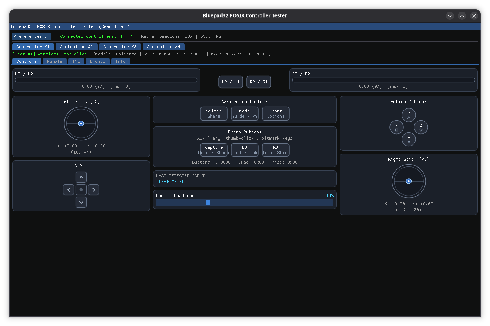

# Bluepad32 Posix ImGui Controller Tester

This desktop GUI application tests Bluepad32 controllers on Linux and macOS. It
uses [Dear ImGui](https://github.com/ocornut/imgui), GLFW, and OpenGL3.



## Features

The application supports up to 4 concurrent Bluetooth gamepads and provides 5
tabs per controller:

* **Controls:** Displays sticks, triggers, buttons, D-pad, and radial deadzone
    in real time.
* **Rumble:** Tests dual-motor force feedback and trigger rumble.
* **IMU:** Displays real-time 3-axis accelerometer (`m/s²`) and gyroscope
    (`rad/s`) dials and history plots.
* **Lights:** Controls player LEDs and the RGB lightbar.
* **Info:** Shows device VID, PID, Bluetooth address, battery level, RSSI, and
    report rate (`Hz`).

## Prerequisites

* **Linux (Debian/Ubuntu):**

    ```sh
    sudo apt install build-essential cmake pkg-config libusb-1.0-0-dev libgl1-mesa-dev libglfw3-dev
    ```

* **macOS (Homebrew):**

    ```sh
    brew install cmake pkg-config libusb glfw
    ```

* **Dear ImGui:**

    Clone Dear ImGui into the `external/imgui` folder:

    ```sh
    git clone --depth 1 https://github.com/ocornut/imgui.git ../../external/imgui
    ```

## Build and Run

Run these commands to build and start the application:

```sh
mkdir build && cd build
cmake ..
make -j
sudo ./bluepad32_posix_imgui_example_app
```

### Command-Line Options

| Option              | Argument  | Description                                                                    |
|---------------------|-----------|--------------------------------------------------------------------------------|
| `-h`, `--help`      | *(none)*  | Print usage help and exit                                                      |
| `-u`, `--usbpath`   | `USBPATH` | Specify the USB port path for the Bluetooth dongle (for example, `1-2:3`)      |
| `-l`, `--logfile`   | `LOGFILE` | Set the PacketLogger (`.pklg`) HCI trace path (default `/tmp/hci_dump.pklg`)   |
| `-r`, `--reset-tlv` | *(none)*  | Reset bonding information in `/tmp/btstack_<bd_addr>.tlv`                      |
| `-b`, `--ble`       | `0\|1`    | Disable (`0`) or enable (`1`, default) Bluetooth Low Energy (BLE) scanning     |
| `-d`, `--delete`    | *(none)*  | Delete saved Bluetooth bonding keys on startup                                 |
| `-e`, `--enhanced`  | *(none)*  | Enable Bluepad32 enhanced controller mode                                      |
